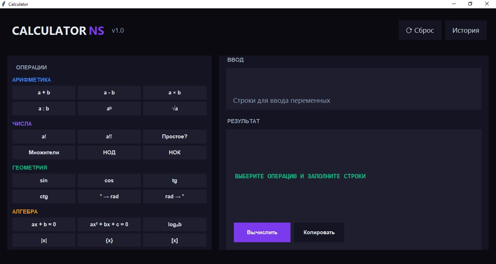
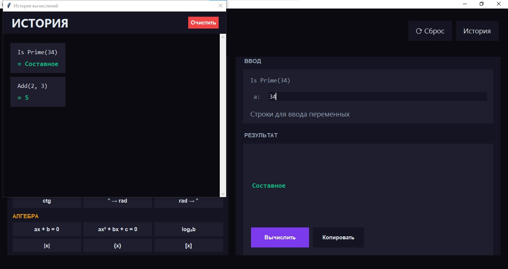

# Calculator v.1

> The first step in the NESTIMS development journey.

| Project Information | Details |
|---|---|
| Project ID | NS-001 |
| Direction | Infotech |
| Development Phase | Phase I |
| Version | v1.0 |
| Platform | Windows / Python |
| Status | Legacy |

> 

## Overview

Calculator v.1 is a multifunctional desktop calculator developed in Python. It represents the first official software project of the NESTIMS ecosystem.

The application combines arithmetic, number theory, trigonometry and algebra in a graphical interface.

## Features

- Basic arithmetic operations

- Powers, roots and logarithms

- Factorials and double factorials

- Prime number testing and factorization

- GCD and LCM calculations

- Trigonometric functions

- Linear and quadratic equations

- Degree and radian conversion

- Persistent calculation history

## Technology Stack

* Python
* Tkinter
* Math
* JSON.

## Installation

- Download the Windows executable from [GitHub Releases](https://github.com/NebulaStack-prog/Calculator-v.1/releases/tag/v1.0).

- Or run with Python: Original source code: [more...](Calculator_v.1.py)

## Documentation

- Russian documentation: [more...](Calculator_v.1_RU.md)
  
- English documentation: [more...](Calculator_v.1_EN.md)

## Project Status

This project is preserved as a historical release of NESTIMS Phase I. Its original implementation documents the early stages of the ecosystem's development.

For an extended version with graph plotting, see [Calculator v.2](https://github.com/NebulaStack-prog/Calculator-v.2).

## Screenshots

© NESTIMS
